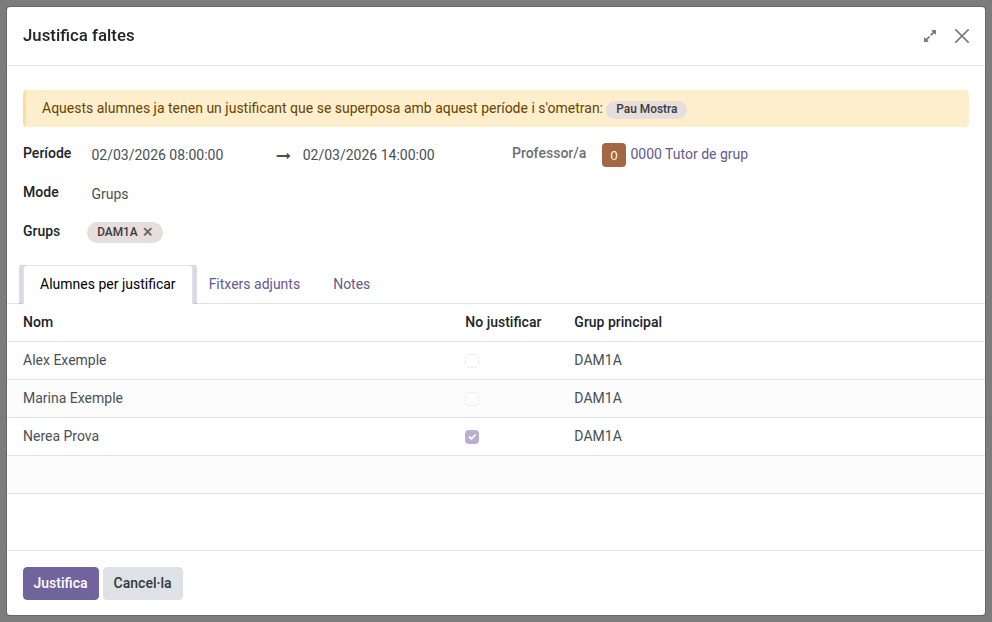
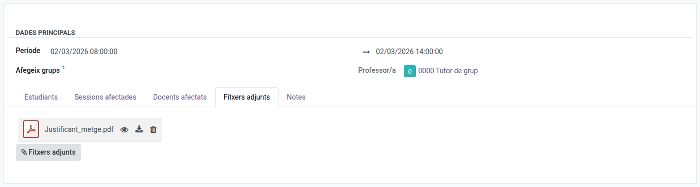
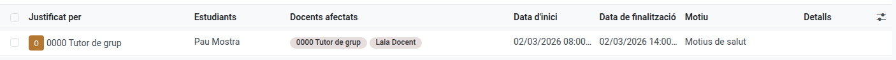

[Català](../../ca/tutors/attendance-justifications.md) | [Castellano](attendance-justifications.md) | [English](../../en/tutors/attendance-justifications.md)

---

# Justificar las faltas de tu alumnado

Un justificante cubre un período (fecha y hora de inicio y de fin) de uno o de varios alumnos: un alumno con cita médica, o un grupo entero en huelga o en un concurso. Todas las faltas de ese período pasan a **Falta justificada**, las haya puesto cualquier docente, y cada **Retraso grave** (que cuenta como falta) pasa a **Retraso leve**. El justificante tiene un solo motivo y un solo conjunto de archivos adjuntos, compartidos por todos sus alumnos.

Salvo que el centro lo permita en su configuración, una justificación es la única forma de justificar una falta: el profesorado no puede marcar a un alumno como Falta justificada al pasar lista.

**Rol necesario:** Tutor

---

## Registrar un justificante

1. Ve a **Asistencia de los estudiantes → Justificaciones** y pulsa **Nuevo**.
2. En **Motivo**, elige por qué (por defecto, **Motivos de salud**). Después:
    - Para la mayoría de motivos, indica la fecha y la hora de inicio y de fin en **Período**.
    - Para una **Huelga**, elige el **Día**: el justificante cubre toda la jornada del alumno.
    - Para **Otros**, descríbelo en **Detalles**, que solo aparece para ese motivo.
3. En **Justificar**, elige para quién es el justificante:
    - **Estudiante** (por defecto): elige al alumno en **Estudiante**. Solo se justifica a ese alumno.
    - **Grupos:** elige los grupos en **Añadir grupos**. Se añaden a la pestaña **Estudiantes** todos sus alumnos, con el nombre y el grupo principal de cada uno. Los grupos se quedan en el selector: si quitas uno, sus alumnos salen de la lista. También puedes pulsar **Añadir una línea** para añadir un alumno más.

    Solo se te ofrecen tus grupos y sus alumnos.
4. Quita de la lista, con la cruz (×), a quien no deba justificarse (por ejemplo, en una huelga, los alumnos que no han firmado el documento).
5. Si quieres, adjunta el documento en la pestaña **Archivos adjuntos** y añade un comentario en **Notas**.
6. Guarda. Las faltas del período de todos los alumnos de la lista pasan a **Falta justificada**, sea cual sea el docente que las puso, y sus retrasos graves a **Retraso leve**.

La pestaña **Sesiones afectadas** muestra, para cada alumno, las sesiones del período en las que tenía una falta o un retraso grave.

En el pase de lista, las líneas justificadas muestran un escudo y el docente ya no puede cambiarlas, salvo que el alumno haya venido a clase después de todo (Asistencia o Retraso leve). Entonces lo ves en tu resumen diario, y el docente puede deshacerlo para recuperar la falta justificada. Su nota indica quién las ha justificado ("Falta justificada por: ..." o "Retraso grave justificado por: ...").

Un alumno no puede tener dos justificantes con períodos que se solapen. Al añadir un grupo, los alumnos que ya tienen uno no se añaden, y un mensaje te indica cuáles son. Si añades uno a mano, un aviso amarillo lo indica: quítalo de la lista para poder guardar.

### Días que aún no han llegado

El período puede incluir días futuros (por ejemplo, un ingreso hospitalario previsto). Cuando un docente pase lista en una sesión de ese período, el alumno ya aparecerá como **Falta justificada**, y la sesión se añadirá a las **Sesiones afectadas** del justificante.

---

## Adjuntar el documento

También puedes adjuntar ficheros a un justificante después de crearlo:

1. Abre el justificante desde la lista de **Justificaciones**.
2. En la pestaña **Archivos adjuntos**, pulsa el botón **Archivos adjuntos** y elige el fichero (por ejemplo, el informe médico). Puedes elegir varios a la vez; cada uno se llama como su fichero.
3. Guarda el justificante.

Con el icono del ojo previsualizas el fichero sin salir del EMS (PDF, imágenes y ficheros de texto); con el icono de descarga lo descargas; con la papelera lo borras al guardar el justificante. En la pestaña **Notas** puedes añadir un comentario.

Los archivos adjuntos los puede abrir cualquiera que pueda ver el justificante: el profesorado de las sesiones afectadas, Jefatura de Estudios y la administración académica.

---

## Consultar, modificar o borrar un justificante

**Asistencia de los estudiantes → Justificaciones** muestra los justificantes de tu alumnado, con los docentes de las sesiones afectadas.

- **Cambiar el período o el motivo:** abre el justificante, modifica el **Período** (o el **Día**, en una huelga) o el **Motivo** y guarda. Las faltas que queden fuera vuelven a **Falta** (o a **Retraso grave**, si lo eran) y las nuevas quedan justificadas.
- **Añadir o quitar alumnos:** añádelos o quítalos en la pestaña **Estudiantes** y guarda. Las faltas de un alumno que quitas vuelven a **Falta** (o a **Retraso grave**).
- **Borrarlo:** las faltas que cubría vuelven a **Falta**, y los retrasos a **Retraso grave**.

Un justificante que incluye alumnos de grupos de los que no eres tutor solo puede modificarlo o borrarlo quien sea responsable de todos ellos (Jefatura de Estudios o la administración académica). Puedes abrirlo igualmente.

La lista muestra el motivo y los detalles de cada justificante. Puedes buscar en ella por alumno, por grupo o por motivo, y agruparla por motivo.

---

[← Volver a los manuales de Tutores](index.md)
