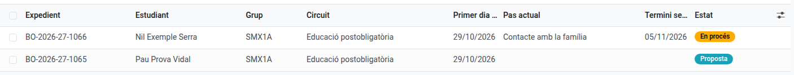
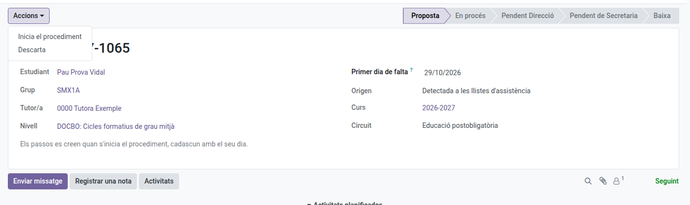
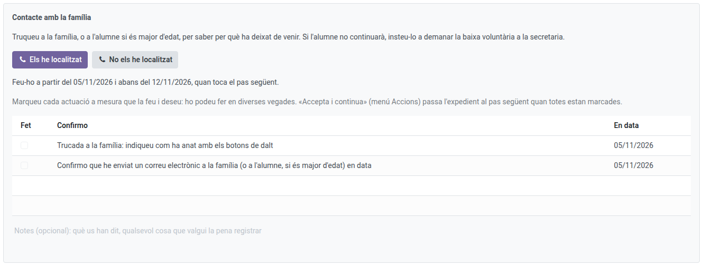
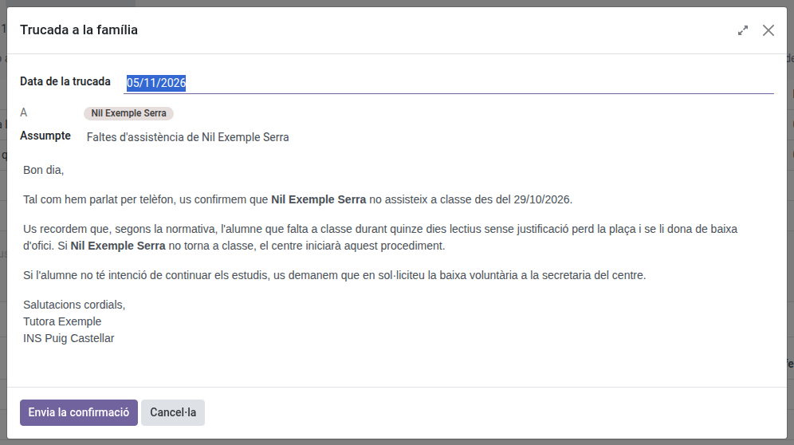
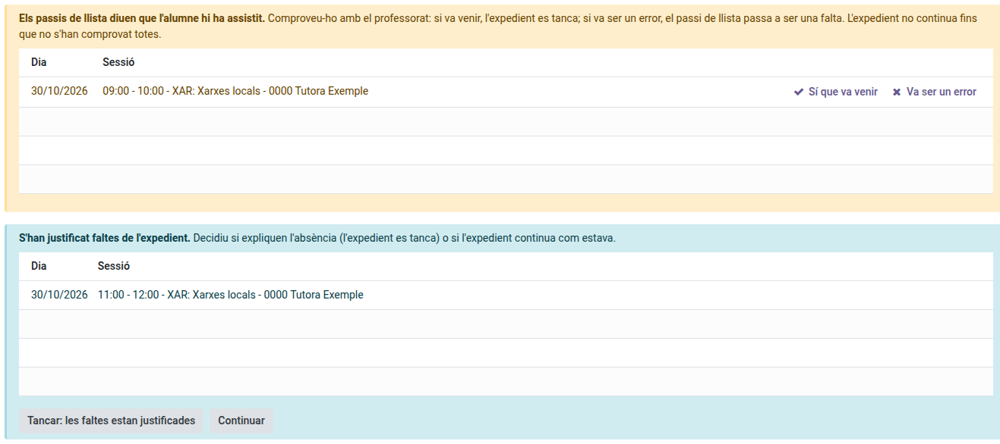

[Català](../../ca/tutors/ex-officio-withdrawal.md) | [Castellano](ex-officio-withdrawal.md) | [English](../../en/tutors/ex-officio-withdrawal.md)

---

# Baja de oficio de un alumno

Esta guía explica qué tienes que hacer cuando un alumno tuyo deja de venir a clase: cómo llega la propuesta de baja de oficio, cómo la inicias o la descartas, cómo haces tu paso (la llamada a la familia y, si hace falta, el correo) y qué pasa si los pases de lista dicen otra cosa mientras el expediente está abierto.

**Rol necesario:** tutor/a del alumno (también el jefe de departamento o de seminario y el jefe de estudios por encima de ti, Dirección y el Administrador)

---

## Índice

1. [Para qué sirve](#para-qué-sirve)
2. [Dónde encontrar los expedientes](#dónde-encontrar-los-expedientes)
3. [La propuesta](#la-propuesta)
4. [Tu paso: contacto con la familia](#tu-paso-contacto-con-la-familia)
5. [Si los pases de lista dicen otra cosa](#si-los-pases-de-lista-dicen-otra-cosa)
6. [Qué pasa después](#qué-pasa-después)

---

## Para qué sirve

Un alumno que deja de venir al centro pierde la plaza al cabo de un plazo. EMS abre un **expediente** que sigue paso a paso el protocolo del centro, con quién ha hecho cada paso y cuándo:

- **Postobligatoria** (CFGM, CFGS, cursos de especialización, PFI): 15 días lectivos sin venir. El 5.º día te toca a ti; el 10.º, a Secretaría; el 15.º, Dirección da el visto bueno y Secretaría tramita la baja.
- **Obligatoria** (CFGB): 2 meses naturales, con una llamada tuya la primera semana, una de Convivencia a los 15 días, los avisos de Secretaría y Servicios Sociales al mes, el aviso de baja al mes y medio y el visto bueno de Dirección a los 2 meses.

Cada paso te da una **tarea** el día que toca, que ves en tu resumen diario.

---

## Dónde encontrar los expedientes

Navega a: **Gestión académica → Bajas de oficio**. Ves los expedientes de tu alumnado, el paso en que está cada uno y cuándo acaba el plazo siguiente.

---

## La propuesta

Una propuesta llega de dos maneras:

- **La detecta EMS:** cuando un alumno acumula 5 días lectivos seguidos en los que ha faltado sin justificar a todos los pases de lista. Los días sin pase de lista o con faltas justificadas no cuentan ni cortan la cuenta; cualquier asistencia o retraso la vuelve a empezar.
- **La pides tú:** en la ficha del alumno, **Acciones → Solicitar la baja de oficio**, e indicas el primer día de falta.

Recibirás la tarea de decidirla. Abre el expediente y, en el menú **Acciones**:

- **Iniciar el procedimiento:** se crean los pasos con sus días.
- **Descartar:** si el alumno tiene un motivo (por ejemplo, una enfermedad), escríbelo y la propuesta se cierra. Solo se volverá a proponer si vuelve a faltar 5 días seguidos más adelante.

---

## Tu paso: contacto con la familia

El día que toca, el expediente te muestra qué tienes que hacer y hasta cuándo. Llama a la familia (o al alumno, si es mayor de edad) y di cómo ha ido con los botones:

- **Los he localizado** o **No los he localizado:** se abre una ventana con el día de la llamada y, en postobligatoria, el correo que EMS ha preparado para la familia (una confirmación o un aviso), que puedes revisar antes de enviarlo.
- **Lo volveré a intentar mañana** (si no los has localizado): no se envía nada y el paso pasa al día lectivo siguiente.

La llamada y el correo quedan marcados solos en la lista, con la fecha, y el texto enviado se guarda en el historial del expediente. Cuando todo está marcado, **Acciones → Aceptar y continuar** pasa el expediente al paso siguiente.

---

## Si los pases de lista dicen otra cosa

Mientras el expediente está abierto (también si aún es una propuesta), EMS revisa los pases de lista de los días del expediente una vez acabada cada sesión:

- **El alumno consta como presente** (o con retraso): el expediente se detiene y recibes la tarea **Comprobar una asistencia**. Compruébalo con el profesorado y haz clic en **Sí que vino** (el expediente se cierra: el alumno ha vuelto) o **Fue un error** (ese pase de lista pasa a falta, con una nota). Si el profesor corrige él mismo el pase de lista, el aviso desaparece solo.
- **Se han justificado faltas del expediente:** recibes la tarea **Revisar faltas justificadas**. Decide si explican la ausencia (**Cerrar: las faltas están justificadas**) o si el expediente sigue como estaba (**Seguir**). Esto no detiene el expediente.

---

## Qué pasa después

Cuando aceptas tu paso, el expediente pasa al responsable siguiente (Convivencia, Secretaría o Dirección), que recibe su tarea el día que toca. Tú sigues viendo el expediente y su **Histórico**, con cada paso hecho, quién lo hizo y cuándo.

Si el alumno pide la baja voluntaria o es expulsado, el expediente se cierra solo.
