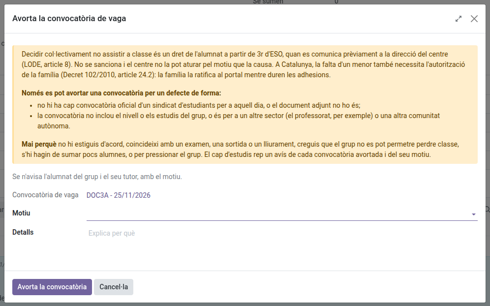

[Català](../../ca/tutors/student-walkout.md) | [Castellano](student-walkout.md) | [English](../../en/tutors/student-walkout.md)

---

# Huelgas de estudiantes: velar por la convocatoria de tu grupo

Cuando el delegado de tu grupo convoca una votación de huelga desde el portal, tú velas por la convocatoria: recibes un aviso de cada paso y la puedes detener si tiene un defecto de forma. La jefatura de estudios solo interviene al final, para validarla o no. Cómo participan el alumnado y las familias se explica en el [manual de familias](../families/manual-vagues.md).

No hay que confundirla con los **Strikes** (Convivencia), el registro disciplinario.

---

## Qué te notifica

Recibes un correo, a la vez que tu grupo, cada vez que pasa algo:

| Cuándo | Qué dice el correo |
|--------|--------------------|
| El delegado convoca la votación | Quién la ha convocado, para qué día, y hasta cuándo vota el grupo |
| El grupo la apoya | El recuento de votos, y hasta cuándo cada alumno dice si se suma |
| La convocatoria se cierra | Si el grupo la apoya y cuántos alumnos se suman |
| La jefatura de estudios la valida | Que la falta de quienes se suman está justificada |
| Se aborta o no se valida | Quién lo ha hecho, y el motivo |

Si eres tutor de un grupo desdoblado, se avisa a cada cotutor. Un grupo sin tutor lo recibe el jefe de estudios y el jefe de estudios adjunto.

---

## Consultar una convocatoria

**Asistencia de los estudiantes > Convocatorias de huelga** muestra las convocatorias de tus grupos. El formulario muestra el calendario, la convocatoria del sindicato, el recuento de votos y, en la pestaña **Alumnado**, quién ha votado (nunca qué), quién se suma y la ratificación de la familia de los alumnos menores de edad.

Un alumno menor que se suma necesita que su familia lo ratifique en el portal mientras duran las adhesiones (Decret 102/2010, artículo 24.2): sin la ratificación, su falta no se justifica. La columna **Se puede justificar** te dice a quién se le justificará la falta si la huelga se valida.

---

## Abortar una convocatoria

Mientras el grupo vota o hay adhesiones, puedes detener la convocatoria: **Acciones > Abortar la convocatoria**. Elige un **Motivo** (y explícalo en **Detalles** si el motivo lo pide) y haz clic en **Abortar la convocatoria**.

**Solo por un defecto de forma.** Decidir colectivamente no asistir a clase es un derecho del alumnado a partir de 3.º de ESO (LODE, artículo 8): el centro no puede impedirla por su causa. La puedes abortar cuando:

- no hay ninguna convocatoria oficial de un sindicato de estudiantes para ese día, o el documento adjunto no lo es;
- la convocatoria no incluye el nivel o los estudios del grupo, o es para otro sector (el profesorado, por ejemplo) u otra comunidad autónoma.

Nunca porque no estés de acuerdo con su causa, coincida con un examen, una salida o una entrega, creas que el grupo no puede permitirse perder clase, o vayan a sumarse pocos alumnos.

Se avisa al alumnado del grupo, con el motivo, y la jefatura de estudios recibe un aviso de cada convocatoria abortada en su resumen diario. Una vez cerrada la convocatoria, solo decide la jefatura de estudios.

También la pueden abortar quienes están por encima de ti en la jerarquía (jefe de departamento o de seminario, jefe de estudios o jefe de estudios adjunto, dirección) y el administrador.

---

[← Volver a los manuales de tutores](index.md)
