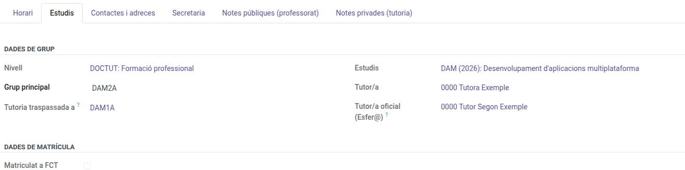

[Català](../../ca/tutors/tutorship-transfer.md) | [Castellano](tutorship-transfer.md) | [English](../../en/tutors/tutorship-transfer.md)

---

# Traspasar la tutoría de un alumno

A veces, un alumno matriculado en 2.º con asignaturas de 1.º pendientes se da de baja de todas las de 2.º y solo cursa las de 1.º. Entonces la secretaría (o el jefe de estudios) puede traspasar su tutoría al grupo de 1.º: el alumno sigue en su grupo de 2.º en Esfer@, pero el seguimiento pasa a ti, el tutor de 1.º.

**Rol necesario:** tutor

---

## Si eres el tutor nuevo (el del grupo al que se ha traspasado la tutoría)

- El alumno aparece entre tu alumnado (**Mi alumnado**) y gestionas sus datos y los de su familia como con cualquier alumno de tu grupo.
- Recibes sus incidencias de asistencia en el resumen diario, los avisos de strikes y el resto de avisos de tutor.
- Participa en las inasistencias colectivas de tu grupo.
- En la pestaña **Estudios** de su ficha, **Tutoría traspasada a** muestra tu grupo, **Tutor/a** te muestra a ti y **Tutor/a oficial (Esfer@)**, al tutor de su grupo principal. No puedes cambiar el traspaso: pídeselo a la secretaría.

## Si eres el tutor oficial (el del grupo principal del alumno)

Sigues poniéndole las notas: las sesiones de evaluación y el expediente van por grupo, y el alumno sigue en el tuyo. Dejas de gestionar sus datos y de recibir avisos sobre él: ahora es tarea del tutor nuevo.

El traspaso termina solo cuando cambia el curso.

---

[← Volver a los manuales de tutores](index.md)
