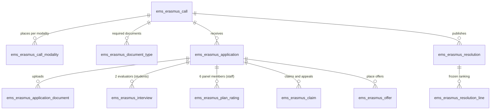
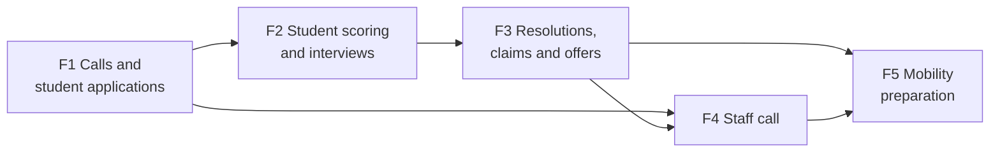

# Erasmus+ calls and mobilities inside EMS

**Status: design, current as of 2026-10-22. Phase 1 (#683) implemented on its branch, not merged yet: what it
ships is described in `docs/en/developers/erasmus/erasmus.md`, which wins over this file where they differ.** Design of record for the
umbrella issue #682 and its phase issues (#683-#687); keep it current as each phase lands, then delete it once the
last phase ships (its contents folded into `docs/en/developers/erasmus/` and the role manuals).

Sources: the centre's draft calls for 2026-27 (`Convocatoria-alumnat-2026-27-ESBORRANY` and
`Convocatoria-personal-2026-27-ESBORRANY`, kept by the Erasmus coordination outside the
repository) and the functional plan agreed with the coordinator on 2026-10-22. Where this file
quotes a rule ("art. N"), the call is the authority: if the call changes, the call wins and this
file is updated. The calls are drafts; this plan adapts EMS to them, it does not validate them.

---

## 1. Goal and approach

The centre runs Erasmus+ mobilities under two projects: KA121-VET (CFGM) and KA131-HED (CFGS).
Every year it publishes two calls: one for **CFGM/CFGS students, any year** (internships abroad)
and one for **vocational training (FP) staff** (job shadowing, structured courses, teaching). Today the
whole process lives in forms, spreadsheets and email.

Goal: run the calls inside EMS. Each applicant sees their own application and what they still
owe; the Erasmus team manages the call, the evaluators score only what they are assigned, and the
results are published in EMS.

Principles:

- **Manual first, automation later.** The grade average, serious sanctions, staff merits and
  deadlines are recorded by a responsible person, with source, date and author. Nothing waits for
  an automatic calculation to exist.
- **A missing value blocks, it is never zero.** A pending average, interview score or panel
  rating prevents closing the evaluation; it does not count as 0 and is not skipped.
- **What was used to select is frozen.** At the call's closing date the data used for scoring is
  copied onto the application. Later corrections are recorded separately, with reason and author;
  a later change in EMS never silently changes a published ranking.
- **One engine, two audiences.** Students and staff share the call, application, document,
  resolution and offer models. Requirements, scoring and checklist differ per audience.
- **Odoo way.** `mail.thread` tracking for history, `mail.activity` for to-dos (they already
  appear in the task digest, `models/shared/task_digest.py`), `ir.attachment` for files, record
  rules for visibility. No parallel task system, no custom versioning engine.

## 2. Where it lives: portal and backend

| Who | Where | What |
|---|---|---|
| Students (portal users) | Portal, `/my/erasmus` | See open calls they can apply to, apply, upload documents, correct during subsanation, follow their state, see published results, accept or renounce a place. |
| Staff (internal users) | **The same portal page**, `/my/erasmus` | Same as students, with the staff form. Odoo's `/my` already works for internal users; EMS only locks `/my/account` for portal users (`controllers/portal_account.py`). |
| Erasmus team | Backend, new root menu *Erasmus+* | Calls, applications, admission, scoring, interviews, resolutions, claims, offers. |
| Interview evaluators, staff panel | Backend, *Erasmus+ > My evaluations* | Only the interviews / plans assigned to them. |
| Director, Head of Studies | Backend | Their reserved validations (serious sanctions, staff activity validation). |

**The *Erasmus+* entry on the portal home appears only to people who can use it:** someone with
an application of their own, or who is eligible for a call that is currently open (a student in a
CFGM/CFGS main group, any year, for the student call; an internal user with an employee for the
staff call). Nobody else sees it. Families do not see the Erasmus+ file by default; a minor's
family authorization is a required document the student uploads (see 4.3).

The staff application goes through the portal, not the backend, so that it is the same flow as
the students' and the staff member does not need any backend menu just to apply.

## 3. What EMS already has and is reused

| Need | Existing piece | Use |
|---|---|---|
| Portal request circuit | `controllers/portal_convalidation.py`, `views/portal/portal_convalidations.xml` | Pattern to copy: sudo with the student resolved server-side, no ids in forms, period open/closed. |
| Student's level and year | `res.partner.main_group_id` → `ems.group.level_id` (CFGM/CFGS) and `ems.group.course` (1/2) | Eligibility for the student call and modality (GM/GS). |
| Grades | `ems.grade_subject_line`, `ems.student.year_record(.subject)` (`final_grade`, `is_convalidated`) | Shown to whoever validates the average. **No ready-made record average exists**: the average is validated by hand (5.1). |
| Conduct warnings | `ems.strike` (`student_id`, `date`, stored `group_id`) | Criterion F, counted and frozen at closing (5.1). |
| Serious sanctions | Nothing structured (`contact_type='expelled'` is a permanent exit only) | Manual check by Director / Head of Studies (4.4). |
| Role → group | `ems.role.group_id` adds the role's holders to a group | `ems.role_erasmus` gets the new Erasmus group (7). |
| Staff leave | `ems.leave_type_training` ("Training: courses, Erasmus, ...") | Unchanged: the mobility itself is still registered as a leave. |
| To-dos | `mail.activity` + task digest | Pending documents, evaluations, offers. |

## 4. Data model

New models under `models/erasmus/`, views under `views/erasmus/` (new root menu, so a new folder,
see CLAUDE.md "views/ mirrors the menus").

### 4.1. Call (`ems.erasmus.call`)

- `name`, `course_id` (`ems.course`), `audience` (`student` / `staff`), `rules_attachment_id`
  (the published call PDF).
- Dates, all entered by hand (no working-day calendar engine): `date_open`, `date_close`
  (Datetime, company tz), subsanation deadline, interview review deadline, claims deadline,
  acceptance deadline. The portal shows them as the published calendar (art. 20).
- `modality_ids` (`ems.erasmus.call.modality`): `code` (GM / GS for students; for staff, the
  project/period lines: GM April, GM June-July, GS June-July), `project` (KA121-VET / KA131-HED),
  `places`, `period`, `destinations` (text, editable; destinations proper are phase 5).
- `document_ids` (`ems.erasmus.call.document`, copied when the call is duplicated): what the call
  asks for, each `required` / `optional` / `minor` (required for minors), `confidential`
  (inclusion evidence, support needs). An alternative format (video → audio) is just another file
  on the same document.
- `min_score` (students: 50; staff: none).
- `state`: `draft` → `published` → `closed` (phase 1); later phases add `evaluation` →
  `provisional` → `definitive` → `done`. Moved only by its own buttons. Applications are accepted
  while `published` and between `date_open` and `date_close` (`is_accepting`).

### 4.2. Application (`ems.erasmus.application`, `mail.thread`)

- `call_id`, `partner_id` (the applicant; for staff, the employee's work contact) and, for staff,
  `employee_id`. Unique per (call, applicant).
- `modality_id` (students: computed from the main group's level, editable by the team).
- Form answers: previous Erasmus+ mobilities (declared), GM availability per period, inclusion
  declared (yes/no, evidence confidential), image consent (separate, voluntary), interest in
  accompanying students (staff), support / work-life balance needs (staff, confidential), staff
  activity proposal (type: job shadowing / course / teaching; entity or "not yet identified";
  destination; dates; duration).
- `state`: `draft` → `submitted` → `subsanation` → `admitted` / `excluded` (phase 1, plus
  `not_submitted` for drafts when the call closes); later phases add `selected` / `reserve` /
  `not_selected` → `accepted` / `renounced`.
- `submitted_at` and a **submission receipt** (PDF or confirmation email with the list of files),
  regenerated on every resubmission. Editable by the applicant until `date_close`; afterwards only
  the documents the team asks for during subsanation.
- Admission: `exclusion_reason`, per-requirement checks (see 4.4).
- Scores: see 5. Frozen values are stored fields filled at closing, never computes over live data.

### 4.3. Documents (`ems.erasmus.application.document`)

One record per (application, document type), with `attachment_ids`. A replaced file is kept
(`ir.attachment` archived, not deleted), so every version stays. `review_state`: `pending` →
`valid` / `needs_change` (with comment). Confidential types are readable only by the Erasmus team
(field `groups` + record rule). Reuses nothing of `ems.student_document` on purpose: that model is
the enrollment file, with its own access rules; Erasmus is a separate file.

### 4.4. Admission checks

Separate from the score. Each check stores result, author, date and note:

| Check | Who | Source |
|---|---|---|
| Students: enrolled in CFGM/CFGS (any year) | Automatic proposal, team confirms | `main_group_id.level_id` |
| Students: no previous Erasmus+ internship in this cycle | Team | Declaration + team knowledge |
| Students: no serious sanction this course | **Director / Head of Studies** | Manual, with reference; restricted |
| Students: family authorization if minor | Team | Document |
| Staff: FP staff in the current course (CFGM, CFGS, CFGB or PFI) | Team | Manual |
| Required documents present | Team | Documents |

"No previous internship in this cycle" (admission) and criterion E "first mobility" (score) are
different rules and stay different fields.

### 4.5. Interviews (`ems.erasmus.interview`) - students

One record per (application, evaluator). The coordination assigns two evaluators per candidate,
from the Erasmus team or any teacher (assigning and removing them is coordination's). Fields:
the 7 rubric criteria of annex 4 (4 general, 3 English), each 0-5 integer; computed general
(0-20) and English (0-15); `state` `draft` → `submitted` → `locked`; `scheduled_at` (email at
least 24 h before, art. 11); `no_show` (excludes, unless force majeure recorded).

- An evaluator sees only their own interviews, and **not the other evaluator's score until both
  have submitted**.
- Final interview score = average of both. One single evaluation only with a recorded justified
  cause (annex 4).
- Until the review deadline, the evaluator can reopen and change their own evaluation; the
  coordination can too. At the deadline, or on publication if earlier, all interviews lock. After
  that, only a coordination **rectification** (reason, author) which applies to the next
  resolution; the evaluator never gets free editing back.

### 4.6. Staff plan ratings (`ems.erasmus.plan_rating`) - staff

The panel is **configured per call** (a list of users with their post), not hard-coded: for
2026-27, Director, Head of Studies (FP), Head of the IT department, IT seminar chief and two Heads
of the Administration department. Every member rates every plan with annex 2's rubric (two
aspects, 0 / 0.5 / 1 each). Plan score = arithmetic mean of all ratings. **All six are required**;
a pending one blocks. An abstention (conflict of interest, or the member is a candidate) is
recorded with the substitute the Director appoints, who then rates instead.

### 4.7. Resolutions (`ems.erasmus.resolution`)

`kind`: `admission` (admitted/excluded list), `provisional`, `definitive`, `rectification`.
Preparing one **freezes** its lines (`ems.erasmus.resolution.line`: application, modality, rank,
total, partial scores, result). Coordination records the Commission's approval (date, minutes
reference) and publishes it by hand. Published lists show **name and four digits of the ID
document** (art. 14), never the private file. A published resolution is never edited; a
correction is a new rectification resolution.

### 4.8. Claims and appeals (`ems.erasmus.claim`)

A simple log: application, `kind` (`claim` after provisional, 3 working days; `appeal` before the
Director, one month), received date, text/attachment, response, resolved date. Claims arrive by
email (art. 14); the team records them. No legal case manager.

### 4.9. Offers (`ems.erasmus.offer`)

Every place offer and its answer: application, offered date, deadline, answer (`accepted` /
`renounced` / `expired`). No answer by the deadline = renounced. When a place frees up, EMS
**proposes** the next reserve of the same modality; coordination confirms the offer with a new
deadline. Never automatic.

## 5. Scoring

### 5.1. Students (art. 12, max 100, min 50 to be eligible)

| | Criterion | Source in EMS |
|---|---|---|
| A | Record average × 4 (max 40) | **Computed by EMS** (agreed 2026-10-22 with the coordinator, after Juan and Fer pointed out EMS holds every grade since 2024-25 and the RA ponderations): every module of the applicant's current cycle, all its years. Past years: `ems.student.year_record.subject.final_grade`. Current course: `ems.grade_subject_line.computed_score` when `internal_is_scored` - a provisional grade from the RAs evaluated so far (`_internal_from_outcomes`: RA-weighted, whole number, capped at 4 if an evaluated RA failed). Failed modules count with their grade; a module with nothing evaluated yet is left out (never 0); convalidated / exempt modules excluded. **Open: plain mean or weighted by module hours** (`ems.subject.total_hours`). Frozen at closing with the list of modules used. Manual value (certificate of previous studies, validated by Secretariat, Erasmus team or Head of Studies) only for applicants with no grades in EMS. |
| B | Interview: general 20 + English 15 | 4.5. Both parts kept (English breaks ties). |
| C | Language certificate, highest only: B1 2.5, B2 5, C1 7.5, C2 10 | Team, from the uploaded certificate. |
| D | Fewer opportunities: 10 or 0 | Team, from the confidential evidence. |
| E | First mobility: 5 | Team (GM: no previous Erasmus+; GS: no previous higher-education one). |
| F | −3 per conduct warning, max −9 | `ems.strike` of the student in the current cycle (every year of it so far; other cycles excluded) up to `date_close`. **Frozen at closing** as a list of strikes + penalty. |

Total = A + B + C + D + E − min(3 × warnings, 9). No floor at zero.
Tie-break: D, E, English part of B, A, recorded draw.

Criterion F, practical note: EMS only has strikes since this course, so for now only the existing
ones can be counted. The screen states the period with data and distinguishes "no earlier records
available" from "no warnings". Matching the cycle uses the strike's stored `group_id.study_id`
against the applicant's study; changes of cycle are checked before implementing.

### 5.2. Staff (art. 11, max 10, no minimum)

| | Criterion | Source |
|---|---|---|
| 1 | Mobility plan (max 2) | Panel mean (4.6). |
| 2 | Last staff mobility: never or > 2 courses 1.5; 2 courses ago 0.5; last/current 0 | Team. Accompanying students doesn't count. |
| 3 | Centre projects: 0.5 per collaboration, 1 per coordination, max 1.5 | Team, merits listed with justification. |
| 4 | Languages, highest only: B2 1, C1 1.5, C2 2 | Team, from certificate. |
| 5 | Continuous seniority at closing: < 1 year 0; 1-2: 1; 2-5: 1.5; ≥ 5: 2 | Team (EMS may not hold the start date). |
| 6 | Internationalisation: 0.5 per activity, max 1 | Team, merits listed. |

Tie-break: never had a staff mobility, plan score, seniority, recorded draw. One place per person
unless places are left over (exception recorded). Assigning a selected person to project and
period is coordination's, checking the project's conditions.

## 6. Menus

New root menu **Erasmus+**, visible to the Erasmus team and to anyone with an evaluation assigned:

- *Calls* (team) - *Applications* (team) - *Resolutions* (team) - *Claims* (team)
- *My evaluations* (anyone with an interview or plan rating assigned)

Created by phase 1 with only what phase 1 delivers (CLAUDE.md / #495 rule: a root menu appears
when it is useful, never half-built).

## 7. Permissions

New groups:

- **`ems.group_erasmus`** - Erasmus team: coordination and the mobility technician. Full access
  to every Erasmus file, including confidential evidence. The technician can do every management
  action coordination does, as a substitute, with the author recorded. Linked from
  `ems.role_erasmus` ("Erasmus coordinator") and a new role "Erasmus mobility technician".
- No group for evaluators: interviews and plan ratings are readable/writable by
  `ems.group_teacher` through a record rule `evaluator_id = user`. Being an evaluator gives no
  access to the rest of the file.

| | Applicant | Evaluator | Erasmus team | Secretariat | Head of Studies | Director |
|---|---|---|---|---|---|---|
| Own application (portal) | R+W until close | - | R+W all | - | - | - |
| Applications | - | R assigned, no confidential | R+W all | R (to validate A) | R | R |
| Confidential evidence | own upload only | - | R+W | - | - | - |
| Validate average (A) | - | - | W | W | W | - |
| Serious-sanction check | - | - | R | - | **W** | **W** |
| Interviews | - | R+W own | R+W all | - | - | - |
| Staff plan ratings | - | R+W own | R+W all | - | R+W if panel | R+W if panel |
| Resolutions, claims, offers | own result | - | R+W | - | R | R |
| Staff activity validation (phase 5) | - | - | R | - | - | **W** |

The administrator (`base.group_system` / `ems.group_academic_admin`) can do everything (CLAUDE.md).
A candidate never rates their own call; abstentions are recorded (4.6).

## 8. Phases

One issue and one branch per phase, branching from the current release branch (or `main` when
there is none), in order, under an umbrella issue that no branch closes.

- **F1 - Calls and student applications** *(medium)*. Call, modalities, document types, the
  student application on `/my/erasmus` (apply, upload, edit until close, receipt), admission
  checks, subsanation, admitted/excluded list. Creates the *Erasmus+* root menu and
  `ems.group_erasmus`. Useful on its own: the call is received in EMS instead of a web form.
- **F2 - Student scoring and interviews** *(medium-large)*. Criteria A-F with freezing at close,
  average validation, strike count, interview assignment with two evaluators, rubric, review
  deadline and locking, ranking and tie-breaks.
- **F3 - Resolutions, claims and offers** *(medium)*. Provisional and definitive resolutions with
  frozen lines, publication on the portal (name + 4 ID digits), claims and appeals log,
  acceptance, renunciation, reserve offers. Closes the student cycle of the first delivery.
- **F4 - Staff call** *(medium)*. Staff application on the same portal page, mobility plan upload,
  panel configuration and ratings, manual merits, staff scoring and tie-breaks, project/period
  assignment, one place per person. Reuses F1-F3.
- **F5 - Mobility preparation** *(large; second delivery)*. Destination choice by rank, own
  proposals, host entity, documents and signers (signed outside EMS and uploaded), checklist per
  modality (OLS, virtual component for GS, return documents), Director validation of staff
  activities.
- **Later (no issue yet):** integrated self-hosted e-signature (third delivery).

Out of scope for all phases: grant calculation and payments, generating official documents,
interview scheduling optimisation, bulk signature, advanced statistics, EWP, AI evaluation.

Execution notes, all phases:

- TDD + DTON as in CLAUDE.md: Spec (dev doc + role manuals), tests, tour, implementation, gate with
  scoped `./test.sh`.
- Tours log in as the least-privileged role: a CFGM/CFGS student for the portal, a plain teacher for
  *My evaluations*, an `ems.group_erasmus` user for management.
- **Email**: every notification (subsanation, interview call, results, offers) goes through
  `mail.template` + `message_post`; tests mock `IrMailServer.send_email` and use `@example.com`
  addresses only.
- Dates in the company timezone (`ems.datetime_utils`); `date_close` is compared with
  `get_local_datetime()`, never the client's clock.
- Manuals: a new role folder `docs/{en,ca,es}/erasmus/` for the team, plus the applicant sections
  in `families/` (students) and `teachers/` (staff, evaluators). New role folder means its
  `index.md` and updating CLAUDE.md's role list.
- Real Catalan/Spanish translations, verified in the database (`TestI18nCoverage`).
- Migrations only if a phase changes something already released; brand-new models need none.

## 9. Open points (do not block F1)

- **Any CFGM/CFGS student can apply, not only 2nd year** (coordinator, 2026-10-22). Art. 6 of the
  student call still says "segon curs" and must be changed before publishing. Art. 4's note on
  graduates doing the summer mobility is information for applicants only: it has no effect on EMS.
- **Staff means FP staff, including those teaching only in PFI or CFGB** (coordinator, 2026-10-22).
  Art. 6 of the staff call says "vinculació amb els cicles formatius de grau mitjà o de grau
  superior"; if PFI/CFGB staff are meant to be included, the text should say so explicitly.
- Where the official call text says "the online form published on the centre's website" (art. 7):
  the calls must be updated to point to EMS before publishing.
- Seniority < 1 year = 0 is agreed but not yet in the staff call text.
- The strike period change (whole cycle) and the "data only since this course" limitation must be
  stated in the student call.
- How to count repeated staff merits per year/role before automating criteria 3 and 6 (manual for
  now).
- How EMS keeps graduates' portal accounts, needed for summer mobilities after graduation (F5).
