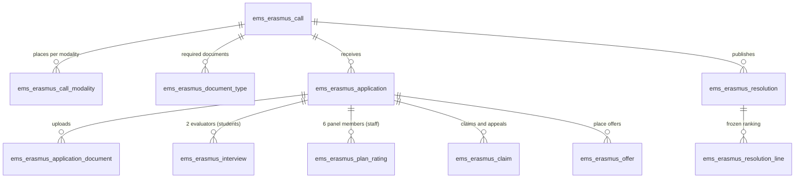
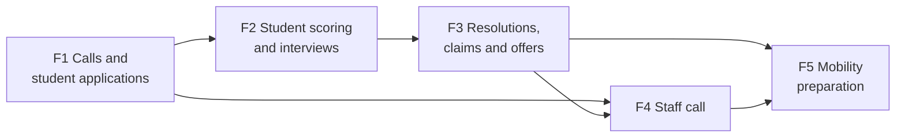
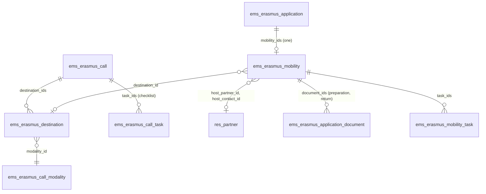
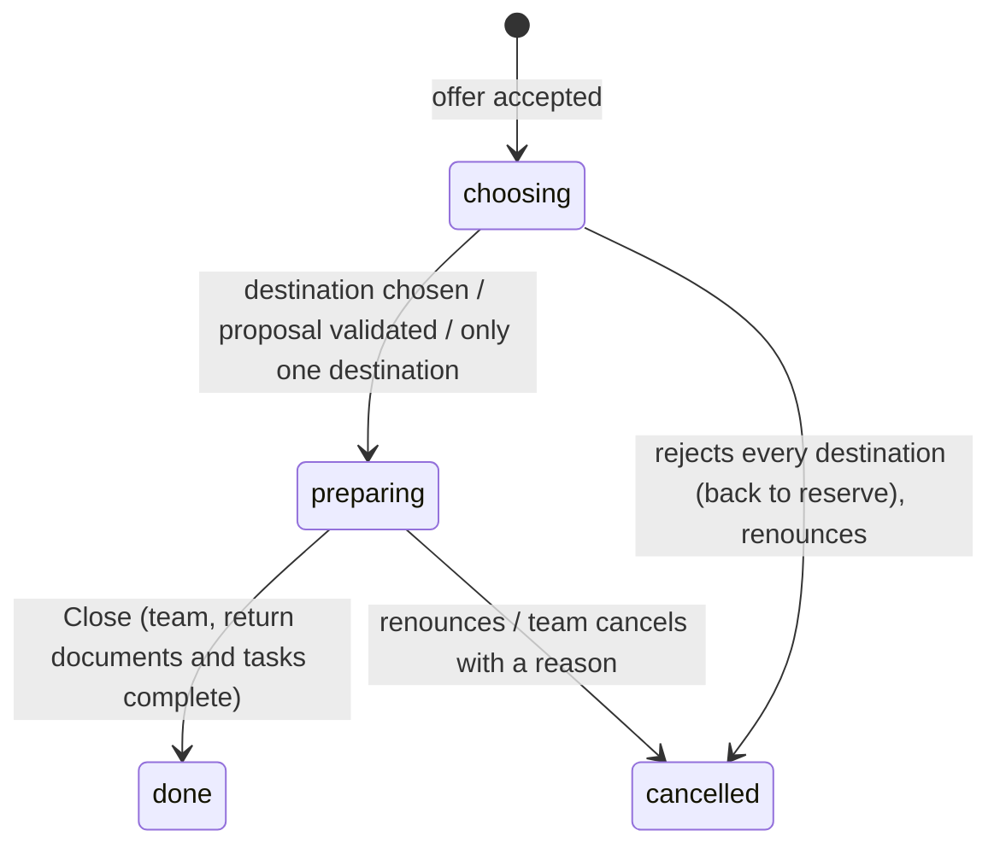

# Erasmus+ calls and mobilities inside EMS

**Status: design, current as of 2026-10-22, partly stale. Phases 1 (#683), 2 (#684), 3 (#685), 4 (#686), 5 (#687, section 10) and 6 (#697, not described here) implemented on their branches (all in `697-erasmus-phase-6`), not merged yet: what it
ships is described in `docs/en/developers/erasmus/erasmus.md`, which wins over this file where they differ.** Known differences since 2026-10-23: there is no manual serious-sanction check (art. 6 is applied from EMS's conduct warnings, 3 or more this course), the staff mobility plan is written in the form, and only FP teachers see the staff call. Design of record for the
umbrella issue #682 and its phase issues (#683-#687); keep it current as each phase lands, then delete it once the
last phase ships (its contents folded into `docs/en/developers/erasmus/` and the role manuals).

Sources: the centre's draft calls for 2026-27 (`Convocatoria-alumnat-2026-27-ESBORRANY` and
`Convocatoria-personal-2026-27-ESBORRANY`, kept by the Erasmus coordination outside the
repository) and the functional plan agreed with the coordinator on 2026-10-22. Where this file
quotes a rule ("art. N"), the call is the authority: if the call changes, the call wins and this
file is updated. The calls are drafts; this plan adapts EMS to them, it does not validate them.

---

## 1. Goal and approach

The centre runs Erasmus+ mobilities under two projects: KA121-VET (CFGM) and KA131-HED (CFGS).
Every year it publishes two calls: one for **CFGM/CFGS students, any year** (internships abroad)
and one for **vocational training (FP) staff** (job shadowing, structured courses, teaching). Today the
whole process lives in forms, spreadsheets and email.

Goal: run the calls inside EMS. Each applicant sees their own application and what they still
owe; the Erasmus team manages the call, the evaluators score only what they are assigned, and the
results are published in EMS.

Principles:

- **Manual first, automation later.** The grade average, serious sanctions, staff merits and
  deadlines are recorded by a responsible person, with source, date and author. Nothing waits for
  an automatic calculation to exist.
- **A missing value blocks, it is never zero.** A pending average, interview score or panel
  rating prevents closing the evaluation; it does not count as 0 and is not skipped.
- **What was used to select is frozen.** At the call's closing date the data used for scoring is
  copied onto the application. Later corrections are recorded separately, with reason and author;
  a later change in EMS never silently changes a published ranking.
- **One engine, two audiences.** Students and staff share the call, application, document,
  resolution and offer models. Requirements, scoring and checklist differ per audience.
- **Odoo way.** `mail.thread` tracking for history, `mail.activity` for to-dos (they already
  appear in the task digest, `models/shared/task_digest.py`), `ir.attachment` for files, record
  rules for visibility. No parallel task system, no custom versioning engine.

## 2. Where it lives: portal and backend

| Who | Where | What |
|---|---|---|
| Students (portal users) | Portal, `/my/erasmus` | See open calls they can apply to, apply, upload documents, correct during subsanation, follow their state, see published results, accept or renounce a place. |
| Staff (internal users) | **The same portal page**, `/my/erasmus` | Same as students, with the staff form. Odoo's `/my` already works for internal users; EMS only locks `/my/account` for portal users (`controllers/portal_account.py`). |
| Erasmus team | Backend, new root menu *Erasmus+* | Calls, applications, admission, scoring, interviews, resolutions, claims, offers. |
| Interview evaluators, staff panel | Backend, *Erasmus+ > My evaluations* | Only the interviews / plans assigned to them. |
| Director, Head of Studies | Backend | Their reserved validations (serious sanctions, staff activity validation). |

**The *Erasmus+* entry on the portal home appears only to people who can use it:** someone with
an application of their own, or who is eligible for a call that is currently open (a student in a
CFGM/CFGS main group, any year, for the student call; an internal user with an employee for the
staff call). Nobody else sees it. Families do not see the Erasmus+ file by default; a minor's
family authorization is a required document the student uploads (see 4.3).

The staff application goes through the portal, not the backend, so that it is the same flow as
the students' and the staff member does not need any backend menu just to apply.

## 3. What EMS already has and is reused

| Need | Existing piece | Use |
|---|---|---|
| Portal request circuit | `controllers/portal_convalidation.py`, `views/portal/portal_convalidations.xml` | Pattern to copy: sudo with the student resolved server-side, no ids in forms, period open/closed. |
| Student's level and year | `res.partner.main_group_id` → `ems.group.level_id` (CFGM/CFGS) and `ems.group.course` (1/2) | Eligibility for the student call and modality (GM/GS). |
| Grades | `ems.grade_subject_line`, `ems.student.year_record(.subject)` (`final_grade`, `is_convalidated`) | Criterion A, computed by EMS and frozen at closing (5.1). |
| Conduct warnings | `ems.strike` (`student_id`, `date`, stored `group_id`) | Criterion F, counted and frozen at closing (5.1). |
| Serious sanctions | Nothing structured (`contact_type='expelled'` is a permanent exit only) | Manual check by Director / Head of Studies (4.4). |
| Role → group | `ems.role.group_id` adds the role's holders to a group | `ems.role_erasmus` gets the new Erasmus group (7). |
| Staff leave | `ems.leave_type_training` ("Training: courses, Erasmus, ...") | Unchanged: the mobility itself is still registered as a leave. |
| To-dos | `mail.activity` + task digest | Pending documents, evaluations, offers. |

## 4. Data model

New models under `models/erasmus/`, views under `views/erasmus/` (new root menu, so a new folder,
see CLAUDE.md "views/ mirrors the menus").

### 4.1. Call (`ems.erasmus.call`)

- `name`, `course_id` (`ems.course`), `audience` (`student` / `staff`), `rules_attachment_id`
  (the published call PDF).
- Dates, all entered by hand (no working-day calendar engine): `date_open`, `date_close`
  (Datetime, company tz), subsanation deadline, interview review deadline, claims deadline,
  acceptance deadline. The portal shows them as the published calendar (art. 20).
- `modality_ids` (`ems.erasmus.call.modality`): `code` (GM / GS for students; for staff, the
  project/period lines: GM April, GM June-July, GS June-July), `project` (KA121-VET / KA131-HED),
  `places`, `period`, `destinations` (text, editable; destinations proper are phase 5).
- `document_ids` (`ems.erasmus.call.document`, copied when the call is duplicated): what the call
  asks for, each `required` / `optional` / `minor` (required for minors), `confidential`
  (inclusion evidence, support needs). An alternative format (video → audio) is just another file
  on the same document.
- `min_score` (students: 50; staff: none).
- `state`: `draft` → `published` → `closed` (phase 1); later phases add `evaluation` →
  `provisional` → `definitive` → `done`. Moved only by its own buttons. Applications are accepted
  while `published` and between `date_open` and `date_close` (`is_accepting`).

### 4.2. Application (`ems.erasmus.application`, `mail.thread`)

- `call_id`, `partner_id` (the applicant; for staff, the employee's work contact) and, for staff,
  `employee_id`. Unique per (call, applicant).
- `modality_id` (students: computed from the main group's level, editable by the team).
- Form answers: previous Erasmus+ mobilities (declared), GM availability per period, inclusion
  declared (yes/no, evidence confidential), image consent (separate, voluntary), interest in
  accompanying students (staff), support / work-life balance needs (staff, confidential), staff
  activity proposal (type: job shadowing / course / teaching; entity or "not yet identified";
  destination; dates; duration).
- `state`: `draft` → `submitted` → `subsanation` → `admitted` / `excluded` (phase 1, plus
  `not_submitted` for drafts when the call closes); later phases add `selected` / `reserve` /
  `not_selected` → `accepted` / `renounced`.
- `submitted_at` and a **submission receipt** (PDF or confirmation email with the list of files),
  regenerated on every resubmission. Editable by the applicant until `date_close`; afterwards only
  the documents the team asks for during subsanation.
- Admission: `exclusion_reason`, per-requirement checks (see 4.4).
- Scores: see 5. Frozen values are stored fields filled at closing, never computes over live data.

### 4.3. Documents (`ems.erasmus.application.document`)

One record per (application, document type), with `attachment_ids`. A replaced file is kept
(`ir.attachment` archived, not deleted), so every version stays. `review_state`: `pending` →
`valid` / `needs_change` (with comment). Confidential types are readable only by the Erasmus team
(field `groups` + record rule). Reuses nothing of `ems.student_document` on purpose: that model is
the enrollment file, with its own access rules; Erasmus is a separate file.

### 4.4. Admission checks

Separate from the score. Each check stores result, author, date and note:

| Check | Who | Source |
|---|---|---|
| Students: enrolled in CFGM/CFGS (any year) | Automatic proposal, team confirms | `main_group_id.level_id` |
| Students: no previous Erasmus+ internship in this cycle | Team | Declaration + team knowledge |
| Students: no serious sanction this course | **Director / Head of Studies** | Manual, with reference; restricted |
| Students: family authorization if minor | Team | Document |
| Staff: FP staff in the current course (CFGM, CFGS, CFGB or PFI) | Team | Manual |
| Required documents present | Team | Documents |

"No previous internship in this cycle" (admission) and criterion E "first mobility" (score) are
different rules and stay different fields.

### 4.5. Interviews (`ems.erasmus.interview`) - students

One record per (application, evaluator). The coordination assigns two evaluators per candidate,
from the Erasmus team or any teacher (assigning and removing them is coordination's). Fields:
the 7 rubric criteria of annex 4 (4 general, 3 English), each 0-5 integer; computed general
(0-20) and English (0-15); `state` `draft` → `submitted` → `locked`; `scheduled_at` (email at
least 24 h before, art. 11); `no_show` (excludes, unless force majeure recorded).

- An evaluator sees only their own interviews, and **not the other evaluator's score until both
  have submitted**.
- Final interview score = average of both. One single evaluation only with a recorded justified
  cause (annex 4).
- Until the review deadline, the evaluator can reopen and change their own evaluation; the
  coordination can too. At the deadline, or on publication if earlier, all interviews lock. After
  that, only a coordination **rectification** (reason, author) which applies to the next
  resolution; the evaluator never gets free editing back.

### 4.6. Staff plan ratings (`ems.erasmus.plan_rating`) - staff

The panel is **configured per call** (a list of users with their post), not hard-coded: for
2026-27, Director, Head of Studies (FP), Head of the IT department, IT seminar chief, and the Head and the seminar chief
of the Administration department. Every member rates every plan with annex 2's rubric (two
aspects, 0 / 0.5 / 1 each). Plan score = arithmetic mean of all ratings. **All six are required**;
a pending one blocks. An abstention (conflict of interest, or the member is a candidate) is
recorded with the substitute the Director appoints, who then rates instead.

### 4.7. Resolutions (`ems.erasmus.resolution`)

`kind`: `admission` (admitted/excluded list), `provisional`, `definitive`, `rectification`.
Preparing one **freezes** its lines (`ems.erasmus.resolution.line`: application, modality, rank,
total, partial scores, result). The Erasmus coordinator alone approves it by publishing it
(decided 2026-10-22: no Commission approval date or minutes). Published lists show **only four digits of the ID document**,
no names (coordinator, 2026-10-22; art. 14 of the student call draft updated accordingly), never the
private file. A published resolution is never edited; a
correction is a new rectification resolution.

### 4.8. Claims and appeals (`ems.erasmus.claim`)

A simple log: application, `kind` (`claim` after provisional, 3 working days; `appeal` before the
Director, one month), received date, text/attachment, response, resolved date. Claims arrive by
email (art. 14); the team records them. No legal case manager.

### 4.9. Offers (`ems.erasmus.offer`)

Every place offer and its answer: application, offered date, deadline, answer (`accepted` /
`renounced` / `expired`). No answer by the deadline = renounced. When a place frees up, EMS
**proposes** the next reserve of the same modality; coordination confirms the offer with a new
deadline. Never automatic.

## 5. Scoring

### 5.1. Students (art. 12, max 100, min 50 to be eligible)

| | Criterion | Source in EMS |
|---|---|---|
| A | Record average × 4 (max 40) | **Computed by EMS** (agreed 2026-10-22 with the coordinator, after Juan and Fer pointed out EMS holds every grade since 2024-25 and the RA ponderations): every module of the applicant's current cycle, all its years. Past years: `ems.student.year_record.subject.final_grade`. Current course: `ems.grade_subject_line.computed_score` when `internal_is_scored` - a provisional grade from the RAs evaluated so far (`_internal_from_outcomes`: RA-weighted, whole number, capped at 4 if an evaluated RA failed). Failed modules count with their grade; a module with nothing evaluated yet is left out (never 0); convalidated / exempt modules excluded. Mean **weighted by module hours** (`ems.subject.total_hours`; decided 2026-10-22). Frozen at closing with the list of modules used. No manual value (decided 2026-10-22): a student new to the centre counts with this course's provisional grades. |
| B | Interview: general 20 + English 15 | 4.5. Both parts kept (English breaks ties). |
| C | Language certificate, highest only: B1 2.5, B2 5, C1 7.5, C2 10 | Team, from the uploaded certificate. |
| D | Fewer opportunities: 10 or 0 | Team, from the confidential evidence. |
| E | First mobility: 5 | Team (GM: no previous Erasmus+; GS: no previous higher-education one). |
| F | −3 per conduct warning, max −9 | `ems.strike` of the student in the current cycle (every year of it so far; other cycles excluded) up to `date_close`. **Frozen at closing** as a list of strikes + penalty. |

Total = A + B + C + D + E − min(3 × warnings, 9). No floor at zero.
Tie-break: D, E, English part of B, A, recorded draw.

Criterion F, practical note: EMS only has strikes since this course, so for now only the existing
ones can be counted. The screen states the period with data and distinguishes "no earlier records
available" from "no warnings". Matching the cycle uses the strike's stored `group_id.study_id`
against the applicant's study; changes of cycle are checked before implementing.

### 5.2. Staff (art. 11, max 10, no minimum)

| | Criterion | Source |
|---|---|---|
| 1 | Mobility plan (max 2) | Panel mean (4.6). |
| 2 | Last staff mobility: never or > 2 courses 1.5; 2 courses ago 0.5; last/current 0 | Team. Accompanying students doesn't count. |
| 3 | Centre projects: 0.5 per collaboration, 1 per coordination, max 1.5 | Team, merits listed with justification. |
| 4 | Languages, highest only: B2 1, C1 1.5, C2 2 | Team, from certificate. |
| 5 | Continuous seniority at closing: < 1 year 0; 1-2: 1; 2-5: 1.5; ≥ 5: 2 | Team (EMS may not hold the start date). |
| 6 | Internationalisation: 0.5 per activity, max 1 | Team, merits listed. |

Tie-break: never had a staff mobility, plan score, seniority, recorded draw. One place per person
(decided 2026-10-22: no extra places). Assigning a selected person to project and
period is coordination's, checking the project's conditions.

## 6. Menus

New root menu **Erasmus+**, visible to the Erasmus team and to anyone with an evaluation assigned:

- *Calls* (team) - *Applications* (team) - *Resolutions* (team) - *Claims* (team)
- *My evaluations* (anyone with an interview or plan rating assigned)

Created by phase 1 with only what phase 1 delivers (CLAUDE.md / #495 rule: a root menu appears
when it is useful, never half-built).

## 7. Permissions

New groups:

- **`ems.group_erasmus`** - Erasmus team: coordination and the mobility technician. Full access
  to every Erasmus file, including confidential evidence. The technician can do every management
  action coordination does, as a substitute, with the author recorded. Linked from
  `ems.role_erasmus` ("Erasmus coordinator") and a new role "Erasmus mobility technician".
- **`ems.group_erasmus_evaluator`** (hidden, managed by EMS as interviews are assigned): interviews
  and plan ratings are readable/writable through a record rule `evaluator_id = user`. Being an
  evaluator gives no access to the rest of the file (not even the CV or video).

| | Applicant | Evaluator | Erasmus team | Head of Studies | Director |
|---|---|---|---|---|---|
| Own application (portal) | R+W until close | - | R+W all | - | - |
| Applications | - | - | R+W all | R | R |
| Confidential evidence | own upload only | - | R+W | - | - |
| Serious-sanction check | - | - | R | **W** | **W** |
| Interviews | - | R+W own | R+W all | - | - |
| Staff plan ratings | - | R+W own | R+W all | R+W if panel | R+W if panel |
| Resolutions, claims, offers | own result | - | R+W | R | R |
| Staff activity validation (phase 5) | - | - | R | - | **W** |

The administrator (`base.group_system` / `ems.group_academic_admin`) can do everything (CLAUDE.md).
A candidate never rates their own call; abstentions are recorded (4.6).

## 8. Phases

One issue and one branch per phase, branching from the current release branch (or `main` when
there is none), in order, under an umbrella issue that no branch closes.

- **F1 - Calls and student applications** *(medium)*. Call, modalities, document types, the
  student application on `/my/erasmus` (apply, upload, edit until close, receipt), admission
  checks, subsanation, admitted/excluded list. Creates the *Erasmus+* root menu and
  `ems.group_erasmus`. Useful on its own: the call is received in EMS instead of a web form.
- **F2 - Student scoring and interviews** *(medium-large; implemented on `684-erasmus-phase-2`, see the
  dev doc. Decided 2026-10-22: a repeated module counts once with its latest grade; A and F freeze when the
  team clicks "Close applications"; evaluators see only their own interview, not the CV or video; an
  automatic hidden group `ems.group_erasmus_evaluator` shows them *My evaluations*; no manual average from a
  certificate of previous studies, the Secretariat has no role in it).* Criteria A-F with freezing at close,
  record average computed by EMS, strike count, interview assignment with two evaluators, rubric, review
  deadline and locking, ranking and tie-breaks.
- **F3 - Resolutions, claims and offers** *(medium; implemented on `685-erasmus-phase-3`, see the dev doc.
  Decided 2026-10-22: the published lists show no names, only rank, masked identity document, total and
  result; the selected get their offer automatically when the definitive resolution is published, a freed
  place goes to the next reserve only when the team confirms it; no new call states).* Provisional and definitive resolutions with
  frozen lines, publication on the portal (4 ID digits, no names), claims and appeals log,
  acceptance, renunciation, reserve offers. Closes the student cycle of the first delivery.
  Also an **"Export to spreadsheet"** action (list of applications and call form, `ems.group_erasmus`
  only, it carries personal data): one `.xlsx` row per person who accepted a place, sheet
  *Participantes*, columns in this exact order and with these exact Spanish headers (an external
  tool imports the file as is; never name that tool in code, docs or changelog): Nombre, Apellidos,
  DNI, Email, Teléfono, Dirección, Fecha de nacimiento, Nacionalidad, Género, Ciclo formativo, Curso,
  Titular de la cuenta, Banco, BIC, IBAN, Tutor legal, Email del tutor legal, Teléfono del tutor
  legal. Only Nombre, Apellidos and DNI are required. Sources: `firstname`/`lastname`, `document_id`
  (else `passport_id`), personal `email`, phone, address, `birth_date` as a real date cell
  (DD/MM/YYYY), `citizenship_id`, the study acronym in force (e.g. SMX), the year of their group (1
  or 2), the first `res.partner.bank` (holder, bank name, BIC, IBAN). Género stays empty (EMS keeps
  no gender for students). Legal guardian columns only for minors, with **every** family contact
  (`_ems_family_contacts()`), joined with ", " in the same order in all three columns (decided
  2026-10-22).
- **F4 - Staff call** *(medium; implemented on `686-erasmus-phase-4`, see the dev doc. Decided 2026-10-22: the
  staff lists show no names either; the panel sees only the mobility plan; Género stays empty in the
  export; the staff's identity document and export data come from their employee file; one ranking for the
  whole call, the team assigns project and period after selection; no work-life balance question in the
  form (the applicant proposes the dates in the plan); no extra places; criterion 4 scores the certificate the
  applicant declares, the team corrects it only if the uploaded one does not match; the applicant also
  declares the month of their last staff mobility from the centre and the month they joined it, which give
  criteria 2 and 5; no substitutes in the panel, abstentions just don't count; ties: plan, then seniority;
  the call opens without places and with the documents of art. 8 preset).* Staff application on the same portal page, mobility plan upload,
  panel configuration and ratings, manual merits, staff scoring and tie-breaks, project/period
  assignment, one place per person. Reuses F1-F3, including "Export to spreadsheet": for staff,
  Ciclo formativo, Curso and the legal guardian columns stay empty (decided 2026-10-22).
- **F5 - Mobility preparation** *(large; second delivery; design in section 10; implemented on `687-erasmus-phase-5`,
  see the dev doc)*. Destination choice by rank
  on the portal, own proposals, host entities, preparation and return documents with signers (signed
  outside EMS and uploaded), checklist per modality, Director validation of staff activities, graduates
  keep the portal until their mobility closes.
- **F6 - Grants, provision of services and host entities** *(#697, on `697-erasmus-phase-6`, from F5;
  see the dev doc)*. Grant per mobility (calculated in the Beneficiary Module, entered in EMS), services
  the centre pays directly (from invoices split among the participants they cover), prefinancing and
  final payments the Secretary transfers (with their receipts), host entities with their tutors and OID,
  the project's documents in SEPIE's 13 folders and a downloadable dossier (ZIP).
- **Later (no issue yet):** integrated self-hosted e-signature (third delivery); then the Learning
  Agreement is sent to the host tutor (the host entity's contact) to sign.

Out of scope for all phases: grant calculation (done in the Beneficiary Module), generating official documents,
interview scheduling optimisation, bulk signature, advanced statistics, EWP, AI evaluation.

Execution notes, all phases:

- TDD + DTON as in CLAUDE.md: Spec (dev doc + role manuals), tests, tour, implementation, gate with
  scoped `./test.sh`.
- Tours log in as the least-privileged role: a CFGM/CFGS student for the portal, a plain teacher for
  *My evaluations*, an `ems.group_erasmus` user for management.
- **Email**: every notification (subsanation, interview call, results, offers) goes through
  `mail.template` + `message_post`; tests mock `IrMailServer.send_email` and use `@example.com`
  addresses only.
- Dates in the company timezone (`ems.datetime_utils`); `date_close` is compared with
  `get_local_datetime()`, never the client's clock.
- Manuals: a new role folder `docs/{en,ca,es}/erasmus/` for the team, plus the applicant sections
  in `families/` (students) and `teachers/` (staff, evaluators). New role folder means its
  `index.md` and updating CLAUDE.md's role list.
- Real Catalan/Spanish translations, verified in the database (`TestI18nCoverage`).
- Migrations only if a phase changes something already released; brand-new models need none.

## 9. Open points (do not block F1)

- ~~Art. 6 of the student call said "segon curs"~~: fixed in the draft 2026-10-22 (also the last sentence
  of art. 4's summer stays row, which said the same). Staff: "professorat de FP" already covers PFI and
  CFGB (coordinator, 2026-10-22), no change.
- ~~Art. 15 of the student call~~: updated in the draft 2026-10-22 (choice on the portal by turns of 72
  hours; a missed turn keeps the place and chooses among what is left).
- Where the official call text says "the online form published on the centre's website" (art. 7):
  the calls must be updated to point to EMS before publishing.
- Seniority < 1 year = 0 is agreed but not yet in the staff call text.
- The strike period change (whole cycle) and the "data only since this course" limitation must be
  stated in the student call.
- How to count repeated staff merits per year/role before automating criteria 3 and 6 (manual for
  now).
- ~~How EMS keeps graduates' portal accounts~~: decided for F5 (section 10.7).

## 10. Phase 5 design: mobility preparation (#687)

Decided with the coordinator 2026-10-22: students choose their destination **on the portal, by
turns**; graduates **keep the portal until their mobility is closed**; a staff member whose proposal
the Director rejects **proposes another one on the portal**; host entities are **reusable contacts**.
The rest are proposals of this design, to confirm when testing.

**Revised with the coordinator after the first implementation (2026-10-22); where the rest of this
section differs, these win (and the dev doc describes what ships):**
- A missed turn keeps the place: the turn passes on and they choose among what is left at the end.
- No "back to the reserve list" button: a student none of whose destinations suits talks to the
  Erasmus team, which agrees an alternative (their own find, or through an intermediary
  organisation) and sets it with *Set the agreed destination*.
- The staff activity is validated by the Direction: the Director or the Head of Studies.
- No identity document among the mobility documents (EMS already has it).
- Deadlines per document: travel documents (health card, commitment letter, minors' authorisations)
  a month after the destination is set; the grant agreement and the learning agreement, filled in by
  the team and then signed, a month before leaving at the latest (ideally three); return documents a
  month after returning. Weekly reminder email while any is missing (art. 17 and annex 1 updated).
- More documents: OLS certificate (English level), inclusion documentation (confidential, optional),
  insurance policy provided by the team (a month before leaving); OLS certificate due a month after the
  destination; the certificate of stay uploaded by the team for the host tutor to sign. A minor's family
  signs the commitment letter too, on its portal. The commitment letter is signed in EMS (text accepted, who,
  when, IP). Projects (`ems.erasmus.project`): CFGM mobilities on VET projects, CFGS on HED.
- Staff complete their proposal with the exact dates and the responsible declaration; when the
  Direction validates it, EMS requests the absence for training on its own, approved as any absence.

### 10.1. Models

- **`ems.erasmus.destination`** (students' call): modality, name, country, city, places, the levels it
  suits (empty = every level of the modality; "places suitable for the profile", art. 15), period
  (start/end dates, may be empty until agreed), host entities, notes. `free_places` = places minus the
  mobilities on it not cancelled. Copied with the call.
- **`ems.erasmus.mobility`** (`ems.base`, chatter and activities): one per application whose place is
  accepted, created when the offer is accepted. Holds what happens after selection; the application
  keeps the selection. Fields: destination, country, city, host entity (`res.partner` company tagged
  *Erasmus+ host entity*) and its contact person, start/end dates, the proposal (own destination of a
  student, or the staff activity) with its decision, preparation/return documents and checklist.
- **`ems.erasmus.call.document`** gets `stage` (`application`, default / `preparation` / `return`),
  `modality_ids` (empty = all) and who signs it (participant, legal guardian, centre, host entity:
  four booleans, signed outside EMS and uploaded). Application lines are created only for
  `application` documents; the mobility gets the `preparation` and `return` ones of its modality.
  Same line model, same review (pending / valid / needs changes), every version kept. Uploaded by the
  participant on the portal or by the team.
- **`ems.erasmus.call.task`** / **`ems.erasmus.mobility.task`**: the checklist of things that are not
  a document (preparation sessions, OLS, GS virtual component, EU Survey, dissemination session), per
  stage and modality; the team ticks them (who and when stamped).
- New call fields: `choice_turn_hours` (length of a choice turn, default 72), `choice_open` (set by
  *Open destination choice*), `preparation_deadline` (travel and preparation documents, art. 17),
  `return_days` (days after the end date to hand in the return documents, default 30, staff art. 15).
- Defaults, added on create like the staff documents of phase 4 (editable): students' preparation
  documents (identity document, European health insurance card, minors' travel authorisation, signed
  commitment letter (annex 3), grant agreement, learning agreement GM / Learning Agreement for
  Traineeships GS) and return (certificate of stay); staff preparation (identity document, health card,
  grant agreement, mobility programme signed by participant, centre and host) and return (certificate
  of stay or attendance, report with evidence). Tasks: students (preparation sessions, OLS course, GS
  virtual component; return: EU Survey, dissemination); staff (preparation meetings, activities left
  for their groups; return: EU Survey, dissemination session).

### 10.2. Mobility states

Cancelling frees the place: the offer becomes `renounced` (or `returned` when the student goes back
to the reserve list) and the team offers it to the next reserve with the existing wizard (never
automatic). A student back on the reserve list keeps their score and is proposed after the other
reserves.

### 10.3. Destination choice (students, art. 15)

- The team configures the destinations, then clicks **Open destination choice** on the call.
- A modality with **one destination**: every mobility of it is assigned directly (art. 15).
- Otherwise, per modality, **one turn at a time**: EMS gives the turn to the best-ranked mobility
  still choosing (and without an own proposal waiting), sets `turn_deadline` = now +
  `choice_turn_hours` and emails it. On the portal they choose among the destinations with free
  places that suit their level, or say none suits them / they are not available (back to the reserve
  list). Choosing ends the turn and starts the next one.
- No answer by the turn's deadline = they lose the turn, not the place (coordinator, 2026-10-22; art. 15
  updated): the hourly cron passes the turn on, and they choose among what is left once the others
  have chosen.
- A reserve who accepts later joins the queue by rank.

### 10.4. Own proposal (students) and staff validation

One proposal block on the mobility for both: country, city, host entity (text), contact email,
dates, activity (staff), a file (the host's written commitment for students), `proposal_state`
(`pending` / `validated` / `rejected`), reason, who decided and when.

- **Student:** proposes it on the portal while choosing (art. 15: the host entity also writes to
  coordination). The **Erasmus team** validates it (the place counts in its modality) or rejects it
  with a reason; rejected, they go back to choosing the centre's destinations.
- **Staff:** the mobility starts with the proposal copied from the application and `pending`; the
  **Director** (`ems.group_director`, or the administrator) validates it or rejects it with a reason
  (staff art. 4 and 14). Rejected, the staff member changes it on the portal and sends it again.
  Validated: preparing. Pending proposals give the validator a to-do (`mail.activity`).
- On validation the team links the host entity contact (creating it if new) and the dates.

### 10.5. Documents, checklist and deadlines

- The portal shows the mobility's documents with who signs each one and the deadline
  (`preparation_deadline`, or end date + `return_days`), and the checklist (read only).
- *Notify pending documents* (team) emails the list of missing or *needs changes* documents.
- `preparation_complete` / `return_complete` (every required line valid, every task done) are shown
  on the list; **Close** needs `return_complete`.

### 10.6. Portal

The call page gets a *Mobility* card for an accepted place: state, turn (destinations to choose,
deadline), own proposal form, staff proposal (editable when rejected), documents to upload, checklist,
and *Renounce the place* (warning about art. 18 costs). Same controller rules as before: the
participant from the session, sudo, state checks in the model.

### 10.7. Graduates (summer mobilities)

The course transition (`_apply_graduates`) does not revoke the portal nor archive a graduate with a
mobility `choosing` or `preparing`; it reports it. When that mobility is closed or cancelled, EMS
revokes the portal and archives the contact as the transition would have.

### 10.8. Access

| | Participant | Erasmus team | Head of Studies | Director |
|---|---|---|---|---|
| Destinations, call tasks | - | rwcu | r | r |
| Mobilities | own (portal) | rwcu | r | r + **validate staff proposals** |
| Mobility tasks | own (portal, read) | rwcu | r | r |

Menu *Erasmus+ > Mobilities* (team, Head of Studies, Director).

### 10.9. Out of scope

Grants and payments, leave registration (the staff mobility is still a training leave, entered as
today), integrated e-signature, generating the documents.
